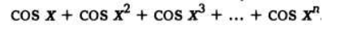
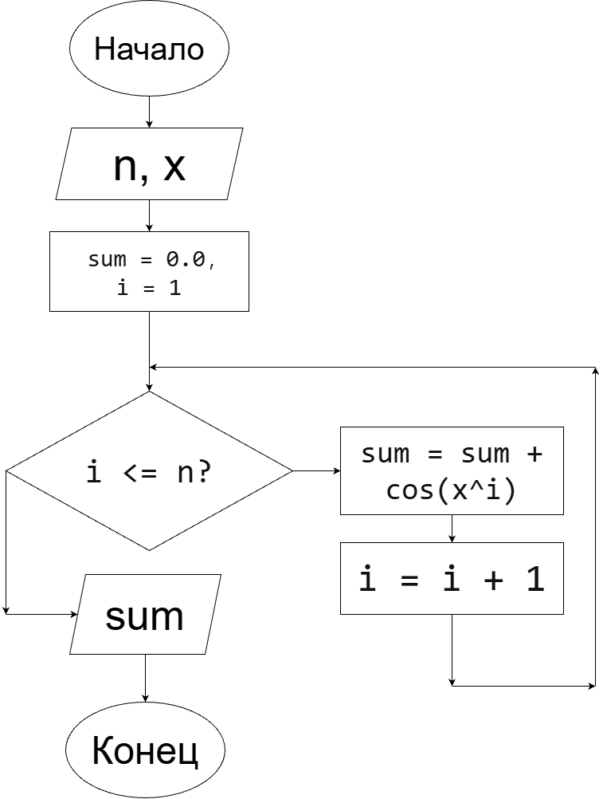
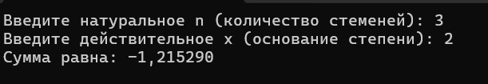

# Домашнее задание к работе 8
## Условие задачи
Вычислите для заданного натурального n и действительного х с использованием цикла for значение <br>

## Решение задачи 
### Аглоритм
 1) Начало
 2) Объявление переменных:<br>
  * int n;
  * double x, sum = 0.0;

3) Ввод данных<br>
printf("Введите натуральное n: ");<br>
scanf("%d", &n);<br>
printf("Введите действительное x: ");<br>
scanf("%lf", &x);<br>

4) Организация цикла for для вычисления суммы<br>
for (int i = 1; i <= n; i++)<br>
sum += cos(pow(x, i));<br>

5) Вывод результата решения<br>
printf("Сумма равна: %lf\n", sum);

6) Конец<br>
### Блок-схема


### Реализация программы
```
#define _CRT_SECURE_NO_WARNINGS 
#define _USE_MATH_DEFINES
#include <stdio.h>
#include <locale.h>
#include <math.h>
#define M_PI 3.14159265358979323846

int main() {
    setlocale(LC_ALL, ".UTF8");
    int n;
    double x, sum = 0.0;

    printf("Введите натуральное n (количество стеменей): ");
    scanf("%d", &n);
    printf("Введите действительное x (основание степени): ");
    scanf("%lf", &x);

    for (int i = 1; i <= n; i++) {
        sum += cos(pow(x, i));
    }

    printf("Сумма равна: %lf\n", sum);
    return 0;
}
```
### Результат работы программы


### Информация о разработчике
Выполнила работу: Кучеренко Дарья, гр.бИЦТ-261, вариант 18